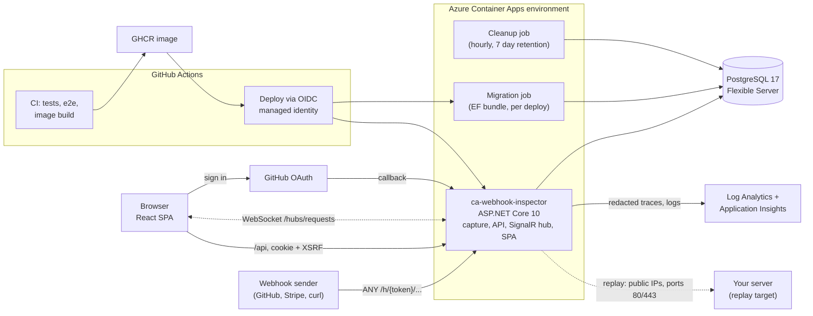

# Webhook Inspector

[](https://github.com/jeghetermats/webhook-inspector/actions/workflows/ci.yml)

Sign in with GitHub, create an endpoint and get a unique URL. Every HTTP request sent to that URL is stored and shows up live in the browser, where it can be filtered, inspected byte for byte, exported as `curl` or replayed to your own server. Useful when building against GitHub, Stripe or Slack webhooks and you want to see exactly what they send.

**[Try the demo](https://ca-webhook-inspector.blueriver-b0d3312f.norwayeast.azurecontainerapps.io/demo)** (made-up data, runs in your browser, no sign-in) or [sign in](https://ca-webhook-inspector.blueriver-b0d3312f.norwayeast.azurecontainerapps.io) to create real endpoints.


| Light | Dark | Mobile |
|---|---|---|
|  |  |  |

## Highlights

- **Correct under concurrency.** Quotas are enforced under a per-endpoint row lock, tested with parallel requests against a real Postgres ([ADR 0005](docs/decisions/0005-quota-under-endpoint-row-lock.md)).
- **Live updates that recover from disconnects.** SignalR only says "something arrived"; the database is the source of truth, and after a reconnect the UI reloads the stored history through keyset pagination, so a missed notification does not mean a missed request ([ADR 0003](docs/decisions/0003-database-as-source-of-truth.md), [ADR 0010](docs/decisions/0010-live-view-contract.md)).
- **Captured data kept out of telemetry.** On the capture route a trace processor keeps only an allowlist of fields. Tests check the app's logs and traces, and a script searches the live service's logs for a planted secret ([live secret check](#live-secret-check)).
- **Replay with SSRF protection.** A stored request can be sent again to a public URL. Addresses on `localhost`, private networks and the cloud metadata service are blocked, and tests cover decimal, hex, octal and IPv6-mapped notations, DNS answers and redirects. The address is checked when the connection is made, which closes the gap DNS rebinding relies on ([ADR 0013](docs/decisions/0013-replay-with-ssrf-protection.md)).
- **Isolation between users.** Every query is scoped to the signed-in user, and another user's resources answer `404`, covered by tests for every route.
- **Measured, not guessed.** A load test found where one small replica breaks. Load shedding and a capped connection pool then replaced 37-second timeouts with fast `503` responses, and 81% of requests were still stored at that load ([results](#load-test)).
- **Cheap to run.** Scale to zero, a burstable database, an ingestion cap on logs and a budget alert.

## Architecture



One ASP.NET Core app serves the capture route, the JSON API, the SignalR hub and the built React app from the same origin, so the session cookie never has to cross origins. A capture request goes through rate limiting and load shedding, has its body read with a size limit before any database work, and is stored in one short transaction that locks the endpoint row and checks the quota. After the commit the owner's browser gets a small notification and fetches the details itself. Migrations and retention cleanup run as separate Container Apps jobs, so the app never changes the schema or deletes data on its own. The design and its trade-offs are in [docs/PLAN.md](docs/PLAN.md) and the [decision records](docs/decisions).

## Tech stack

- **Backend:** C#, ASP.NET Core (.NET 10), EF Core with PostgreSQL, SignalR
- **Frontend:** React, TypeScript, Vite, TanStack Query
- **Auth:** GitHub OAuth with cookie authentication
- **Tests:** xUnit with Testcontainers (real Postgres), Vitest, Playwright, k6
- **Cloud:** Azure Container Apps, Azure Database for PostgreSQL, Bicep, GitHub Actions with OIDC

## Running locally

Requirements: .NET 10 SDK, Node.js 24, Docker.

```bash
# 1. Start Postgres
docker compose up -d

# 2. Create the database schema
dotnet tool restore
dotnet ef database update --project src/WebhookInspector.Api

# 3. Start the API (http://localhost:5080)
dotnet run --project src/WebhookInspector.Api

# 4. Start the frontend (http://localhost:5173)
cd web
npm install
npm run dev
```

### GitHub sign-in for local development

1. Create an OAuth app (not a GitHub App, see [ADR 0011](docs/decisions/0011-github-oauth-app-for-sign-in.md)) at <https://github.com/settings/developers> with
   - Homepage URL: `http://localhost:5173`
   - Redirect URI: `http://localhost:5173/signin-github` (wildcard matching and device flow off)
2. Store its credentials as user secrets (never in `appsettings`):

   ```bash
   dotnet user-secrets set "Authentication:GitHub:ClientId" "<client id>" --project src/WebhookInspector.Api
   dotnet user-secrets set "Authentication:GitHub:ClientSecret" "<client secret>" --project src/WebhookInspector.Api
   ```

3. Open <http://localhost:5173/auth/login>. Without these settings `/auth/login` returns `503`; everything else still works.

Browsers treat `http://localhost` as a secure context, so the `Secure` cookies work locally without HTTPS.

The demo at <http://localhost:5173/demo> needs neither the API nor a database.

Send a request to an endpoint's capture URL:

```bash
curl -X POST "http://localhost:5080/h/<token>/github?x=1" -H "Content-Type: application/json" -d '{"hello":"world"}'
```

## API

All `/api` routes need a signed-in user. Every non-GET request under `/api` and `/auth` needs the antiforgery token from `GET /api/antiforgery` in the `X-XSRF-TOKEN` header. Another user's resources return `404`.

| Method | Route | Purpose |
|---|---|---|
| ANY | `/h/{token}/{**path}` | Public capture route (GET, POST, PUT, PATCH, DELETE, HEAD, OPTIONS) |
| GET | `/auth/login?returnUrl=` | Sign in with GitHub |
| POST | `/auth/logout` | Sign out |
| GET | `/api/antiforgery` | Issue the antiforgery token |
| GET | `/api/me` | Current user |
| GET, POST | `/api/endpoints` | List with usage / create (max 10) |
| PATCH, DELETE | `/api/endpoints/{id}` | Rename / delete with all requests |
| POST | `/api/endpoints/{id}/rotate-token` | New capture URL; the old one stops working |
| DELETE | `/api/endpoints/{id}/requests` | Clear history |
| GET | `/api/endpoints/{id}/requests?cursor=&limit=&method=&pathPrefix=&from=&to=` | Newest first, keyset pagination |
| GET, DELETE | `/api/requests/{id}` | Full detail / delete one |
| GET | `/api/requests/{id}/body` | Raw body as an attachment |
| GET, POST | `/api/requests/{id}/replays` | Earlier attempts, newest first / replay to `{ "targetUrl": "https://…" }` |
| GET | `/health/live`, `/health/ready` | Liveness / database readiness |
| WS | `/hubs/requests` | SignalR hub (sign-in required): `Subscribe(endpointId)`, then `RequestReceived` events with id, method, path, time, size and cursor (no body, headers or query) |

## Limits

| Limit | Value |
|---|---|
| Body size | 256 KB (`413` above) |
| Headers | 64 headers, 32 KB in total |
| Rate limit | 120 requests/min per capture token, 300/min per source IP (`429`) |
| Quota per endpoint | 1,000 requests and 50 MB of body bytes (`429`) |
| Replay | Public addresses on ports 80 and 443 only, 5 s timeout, 64 KB of the response kept, 10 per user per minute (`429`), 8 at once (`503`), last 20 attempts per request |

## Tests

```bash
dotnet test          # backend integration tests; Docker must be running (Testcontainers)
cd web && npm test   # frontend unit tests (body decoding, curl export, API client, live updates, demo)
cd web && npm run e2e  # Playwright end-to-end tests against the real app
```

The end-to-end tests build the SPA, start the API in the `Testing` environment with test sign-in enabled, and use the docker-compose database (run `docker compose up -d` and `dotnet ef database update` first). Test sign-in (`POST /test/sign-in`) only exists when the environment is `Testing` **and** `TestSignIn:Enabled` is true; the app refuses to start if the flag is set anywhere else.

## Deployment (Azure)

Everything runs in one resource group, `rg-webhook-inspector` (Norway East), defined in [`infra/main.bicep`](infra/main.bicep):

| Resource | Setting |
|---|---|
| Container App `ca-webhook-inspector` | 0.25 vCPU, 0.5 GiB, 0 to 1 replicas, external HTTPS ingress |
| Container Apps Job `caj-webhook-inspector-migrate` | Manual trigger, runs the EF Core migration bundle from the image |
| Container Apps Job `caj-webhook-inspector-cleanup` | Every hour at :17, deletes requests older than 7 days ([ADR 0009](docs/decisions/0009-cleanup-as-a-scheduled-job.md)) |
| Workbook "Webhook Inspector operations" | Capture traffic by status, latency p50/p95/p99, server errors, cleanup runs, failures that need attention |
| PostgreSQL Flexible Server | Burstable B1MS, 32 GB, Postgres 17 |
| Log Analytics + Application Insights | 0.15 GB/day ingestion cap, 30 days retention |
| Budget | Email at 5 and 20 USD of monthly usage (only a notification, not a cap) |

### Pipelines

- **CI** (`ci.yml`): every push and pull request. Backend tests with Testcontainers, frontend lint/typecheck/tests/build, Playwright end-to-end tests against the real app and Postgres, Bicep build and Docker build.
- **Deploy** (`deploy.yml`): after CI succeeds on `main`. Pushes the image to GHCR, runs the migrate job with the new image, then updates the app ([ADR 0008](docs/decisions/0008-migrations-as-a-separate-job.md)).
- **Infra** (`infra.yml`): manual. Deploys the Bicep and keeps the app on its current image.

Both deploying workflows log in to Azure with OIDC through a managed identity, so no Azure credential is stored in GitHub ([ADR 0012](docs/decisions/0012-managed-identity-for-deploy-login.md)).

### GitHub `production` environment

| Type | Name | Purpose |
|---|---|---|
| Variable | `AZURE_CLIENT_ID`, `AZURE_TENANT_ID`, `AZURE_SUBSCRIPTION_ID` | OIDC login (managed identity `id-github-deploy`) |
| Variable | `BUDGET_ALERT_EMAIL` | Where budget alerts go. Empty skips the budget |
| Secret | `POSTGRES_ADMIN_PASSWORD` | Database administrator password |
| Variable | `GH_OAUTH_CLIENT_ID` | Production GitHub OAuth app. Empty disables sign-in (`503`) |
| Secret | `GH_OAUTH_CLIENT_SECRET` | Production GitHub OAuth app secret |

### First deploy

1. Push to `main`. CI runs, then Deploy builds and pushes the image. Its deploy step warns that the infrastructure does not exist yet; that is expected.
2. Make the image public: GitHub profile → **Packages** → the package → **Package settings** → **Change visibility** → Public. Container Apps pulls it without credentials. The image contains no secrets.
3. Run the **Infra** workflow (Actions → Infra → Run workflow). The first run takes 10 to 15 minutes, mostly for Postgres. The run summary shows the app URL.
4. Create the production GitHub OAuth app with the redirect URI `<app URL>/signin-github`, set `GH_OAUTH_CLIENT_ID` and `GH_OAUTH_CLIENT_SECRET`, and run **Infra** again.
5. Run the live secret check below. **Do not send real webhook data before it passes.**

After that, every push to `main` deploys automatically once CI is green.

### Live secret check

[`scripts/check-telemetry-leak.ps1`](scripts/check-telemetry-leak.ps1) sends a unique secret in the body, headers, query and path to the live service, waits until the app's own log lines for those requests are in Log Analytics, and then searches every table for the secret and the capture token. Run it after the first deploy and after any telemetry change:

```powershell
az login
./scripts/check-telemetry-leak.ps1 -BaseUrl https://<app URL> -Token <capture token of one of your endpoints>
```

Create an endpoint called "leak check" in the live UI and pass the last part of its capture URL as `-Token`.

### Known limitations (v1)

- Postgres accepts connections from any Azure service (Consumption Container Apps have no fixed outbound IP). TLS and the password protect it; private networking is a v2 improvement.
- The app connects as the Postgres administrator. A separate least-privilege role is a v2 improvement.
- Data Protection keys are stored unencrypted in the database (see [ADR 0002](docs/decisions/0002-cookie-authentication.md)).
- The first request after a quiet period has a cold start of a few seconds ([ADR 0007](docs/decisions/0007-scale-to-zero.md)).
- Replay cannot reach `localhost` or ports other than 80 and 443, by design. To replay to your own machine, expose it through a tunnel such as ngrok or Cloudflare Tunnel.

## Load test

A k6 test against the live service, with one 0.25 vCPU replica and the smallest Postgres server:

- Up to 25 requests/s, every request was stored, with a median of 44 ms from a PC in Norway.
- At 50 requests/s the first run fell over: database connections ran out and 1760 of 2039 requests failed after up to 37 seconds.
- After adding load shedding and capping the connection pool, the same 50/s stored 3044 of 3750 requests (81%) and turned the other 706 away with a fast `503`, with no timeouts or exceptions. Live notifications kept arriving within 1.6 s at p95.

Setup, all numbers, how the outcomes are counted and how to run it yourself: [docs/performance.md](docs/performance.md).
